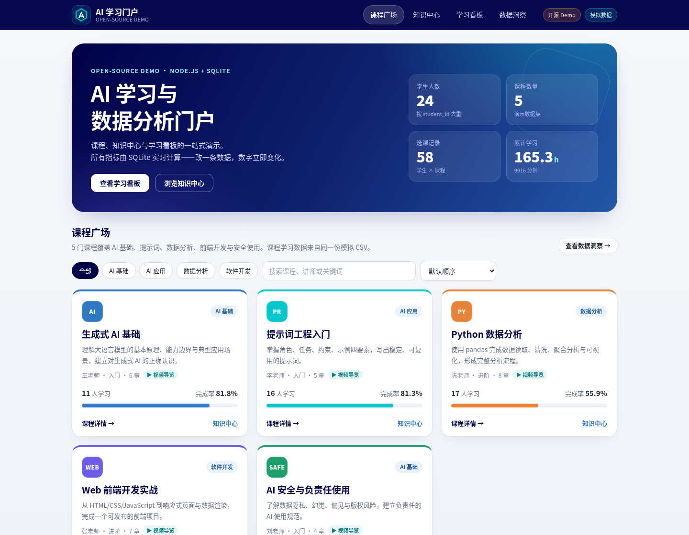
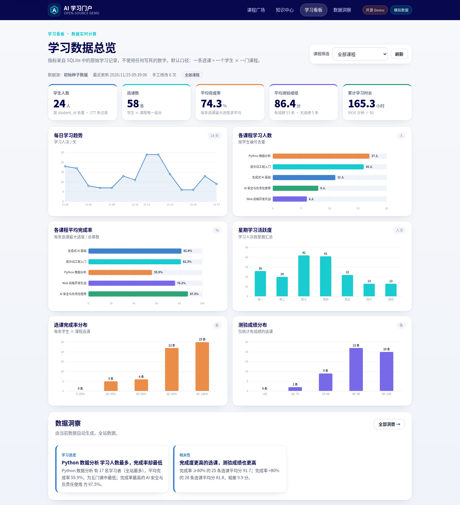
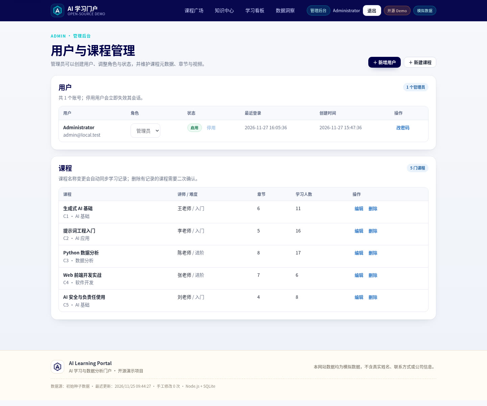

# AI Learning Portal

**A zero-dependency Node.js + SQLite demo portal for courses, knowledge bases, and learning analytics.**

[中文](README.md) · [Architecture](docs/ARCHITECTURE.md) · [Demo guide](docs/DEMO_GUIDE.md) · [Contributing](CONTRIBUTING.md)

[](#quick-start)
[](#stack)
[](#stack)
[](LICENSE)



| Dashboard (admin, with playground) | Admin area |
|---|---|
|  |  |

A runnable reference implementation of a learning portal: course catalog, course detail, chapter pages, knowledge center, learning dashboard, and data insights. Every KPI is computed from SQLite — edit one record and all numbers and charts update.

> Demo/template project: all data and course content are simulated. Session login and an admin area are included, but there is no email verification, password recovery email, MFA, or audit logging. Do not use it as-is in production.

> Live demo (early deployment, may lag behind `main`): https://77fpveqc.qwenwork.host/

## Features

- Course catalog with category filters, keyword search, and sorting.
- Course detail with a sample video, chapter list, and inferred chapter reach rates.
- 30 chapter pages with lecture text, a shared sample video, a chapter quiz, and chapter statistics.
- Knowledge center with summaries, key points, glossary, FAQs, and auto-graded quizzes.
- Learning dashboard: 5 KPIs, 6 hand-written SVG charts, course filter.
- Data insights generated from the current dataset.
- Registration, login, logout with scrypt password hashing and HttpOnly session cookies.
- Admin user management: create users, change roles, enable/disable accounts, reset passwords; last admin protection.
- Admin course management: course metadata, video config, chapter create/edit/delete.
- Editable data playground (admin only): CRUD, CSV import/export, reset to seed data.
- Zero npm dependencies, zero build step, works offline.
- Responsive layout for desktop and mobile.

## Quick start

Requires **Node.js ≥ 24** (built-in `node:sqlite`).

```bash
git clone https://github.com/shinvdu/ai-learning-portal.git
cd ai-learning-portal
npm start
# open http://127.0.0.1:8787
```

No `npm install` is needed. On first run, the app creates `data/portal.db`, imports 177 simulated learning records, and bootstraps an admin account.

Set the admin credentials explicitly for a predictable login:

```bash
ADMIN_EMAIL=admin@example.com ADMIN_PASSWORD='change-me-please' npm start
```

If `ADMIN_PASSWORD` is omitted, a random password is generated and printed once in the startup log. Learners can register from the UI; admins use the “管理后台” link in the header.

If the only admin is locked out, reset it from the CLI (this revokes that account's sessions):

```bash
ADMIN_EMAIL=admin@example.com ADMIN_PASSWORD='new-strong-password' npm run admin:reset
```

LAN demo: `HOST=0.0.0.0 npm start`.

## Stack

| Layer | Choice | Notes |
|---|---|---|
| Backend | Node.js 24 `node:http` | Hand-written router, static files, JSON API |
| Database | `node:sqlite` | Built into Node; no native module |
| Frontend | Vanilla ES Modules + hash routing | No framework, no build |
| Charts | Hand-written SVG | No ECharts / CDN |
| Video | 8-second MP4 generated with ffmpeg | HTTP Range supported |
| Auth | `node:crypto` scrypt + SQLite sessions | HttpOnly / SameSite cookies, zero dependencies |
| Tests | `scripts/verify.js` | Metrics, content, chapters, assets (temporary DB) |

## Data and metrics

Demo dataset: **177 records / 24 students / 5 courses / 58 enrollments**.

| Metric | Definition | Demo value |
|---|---|---|
| Students | `COUNT(DISTINCT student_id)` | 24 |
| Courses | `COUNT(DISTINCT course_name)` | 5 |
| Enrollments | distinct `student_id + course_name` | 58 |
| Avg. completion | per enrollment `max(chapters_done) / total_chapters`, then average | 74.3% |
| Avg. quiz score | per enrollment, scored enrollments only | 86.4 (53 scored / 5 missing) |
| Total learning time | `SUM(learning_minutes) / 60` | 165.3 hours |

Missing quiz scores are **not** zero.

### Chapter reach (inferred)

The raw CSV only contains the total number of completed chapters. Chapter pages therefore use an explicitly labelled inference:

```text
reach rate = enrollments with max(chapters_done) >= chapter index / all enrollments
```

This assumes sequential progress. It is a presentation aid, not raw per-chapter data. For exact chapter analytics, add a `chapter_id` field to the source data.

## API

| Method | Path | Description |
|---|---|---|
| GET | `/api/auth/me` | Current user (null when signed out) |
| POST | `/api/auth/register` | Register a learner and start a session |
| POST | `/api/auth/login` | Sign in |
| POST | `/api/auth/logout` | Sign out |
| GET / POST | `/api/admin/users` | List / create users (admin) |
| PATCH | `/api/admin/users/:id` | Role, active flag, password (admin) |
| GET / POST | `/api/admin/courses` | List / create courses (admin) |
| PATCH / DELETE | `/api/admin/courses/:id` | Update / delete course (admin) |
| POST / PATCH / DELETE | `/api/admin/courses/:id/chapters...` | Chapter management (admin) |
| GET | `/api/meta` | Overview, dataset status |
| GET | `/api/courses` | Courses with stats |
| GET | `/api/courses/:id` | Course detail, stats, chapter reach |
| GET | `/api/chapters/:courseId/:idx` | Chapter text, video metadata, quiz, stats |
| GET | `/api/knowledge/:id` | Knowledge center content |
| GET | `/api/dashboard?course=` | KPIs, charts, insights |
| GET | `/api/insights` | Generated insights, formulas, pitfalls |
| GET | `/api/records` | Paginated learning records (admin) |
| POST / PATCH / DELETE | `/api/records...` | Record CRUD (demo, unauthenticated) |
| POST | `/api/records/import` | Replace all records from CSV |
| POST | `/api/admin/reset` | Restore seed CSV |
| GET | `/api/export.csv` | Export current records |

## Configuration

| Variable | Default | Purpose |
|---|---|---|
| `PORT` | `8787` | Port |
| `HOST` | `127.0.0.1` | Bind address (`0.0.0.0` for LAN) |
| `PORTAL_DB` | `data/portal.db` | SQLite database path |
| `ADMIN_EMAIL` | `admin@local.test` | Email for the bootstrapped admin |
| `ADMIN_PASSWORD` | generated and printed once | Password for the bootstrapped admin (min 8 characters) |

## Development

```bash
npm run dev      # node --watch
npm run seed     # restore seed data
npm run verify   # validate metrics, content, chapters, assets (temporary DB)
npm test
```

`verify` uses a temporary database and does not touch `data/portal.db`. `seed` resets learning records only; users and courses are preserved.

## Security

- Demo-grade auth: scrypt password hashing, SQLite sessions, HttpOnly + SameSite=Lax cookies, login/register rate limiting.
- Role check: raw record access and all admin endpoints require an admin session.
- Bootstrap the admin with `ADMIN_EMAIL` / `ADMIN_PASSWORD`; the last active admin cannot demote or disable themselves.
- Same-origin checks on mutating requests, parameterized SQL, CSV validation, HTML escaping, CSP, 2 MB body limit.
- No email verification, password recovery email, MFA, audit log, or multi-tenancy.
- Use simulated data only. See [SECURITY.md](SECURITY.md).

## Project layout

```text
server.js            HTTP server and API routes
src/                 database, analytics, auth, content, CSV
public/              index.html, CSS, vanilla JS, sample video
data/                seed CSV, lecture texts, SQLite DB (generated)
scripts/             seed and verification scripts
docs/                architecture, demo guide, screenshots
```

## License

[MIT](LICENSE) © 2026 AI Learning Portal contributors

Sample course texts, student data, and video are placeholder content for demonstration only.