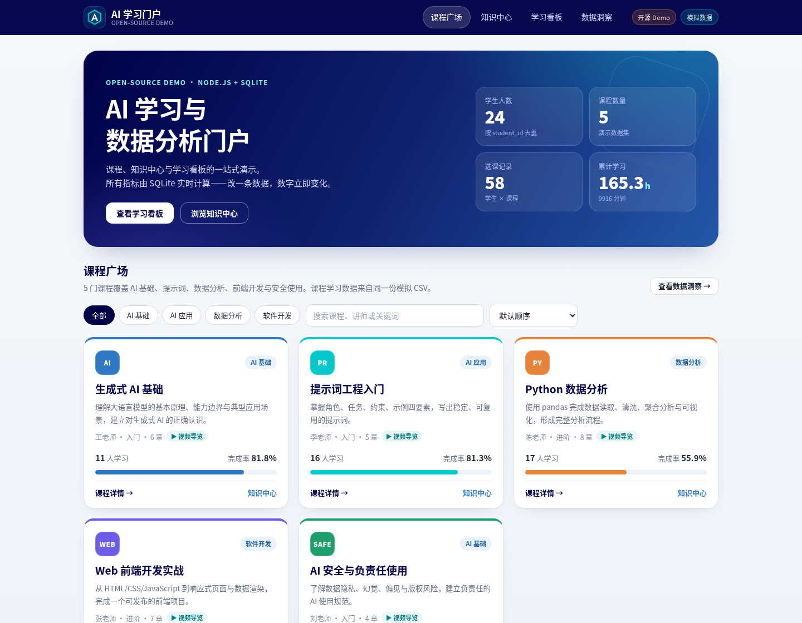
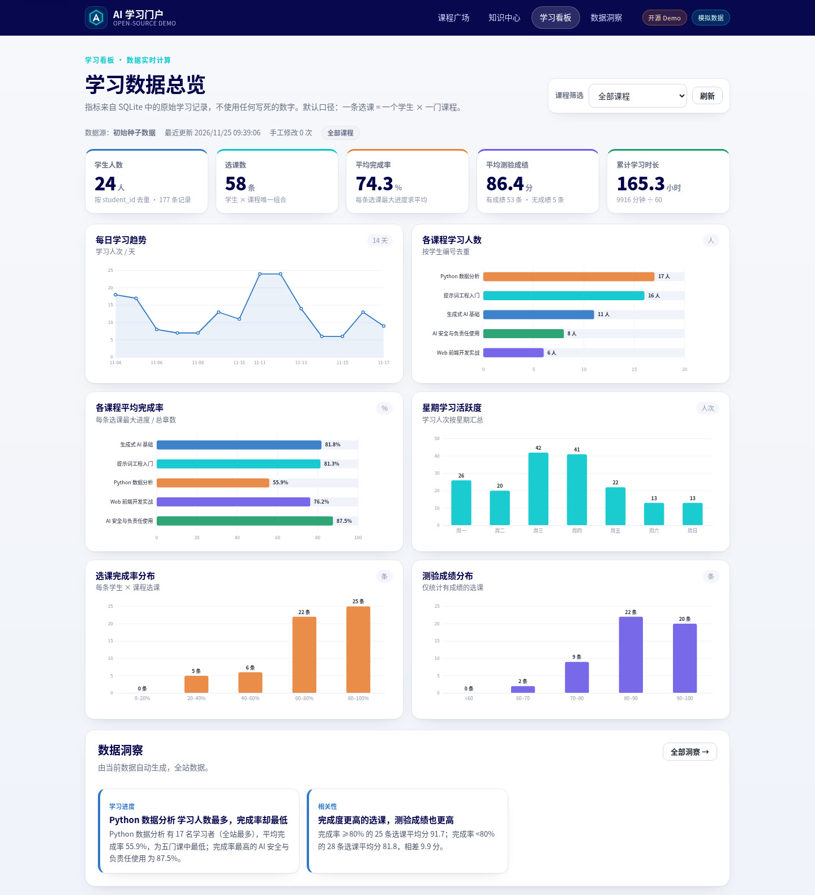
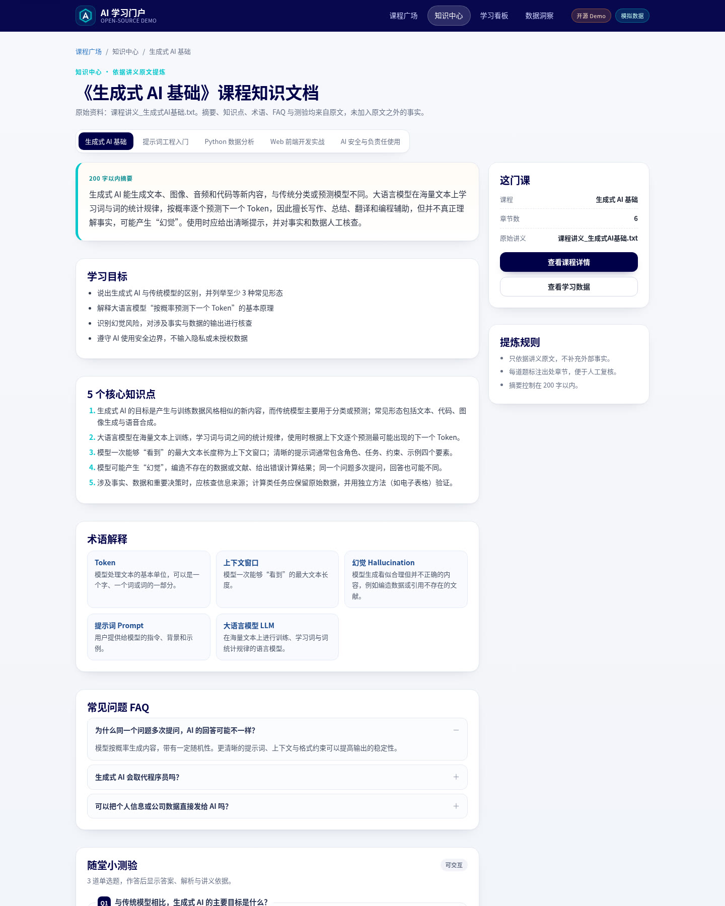
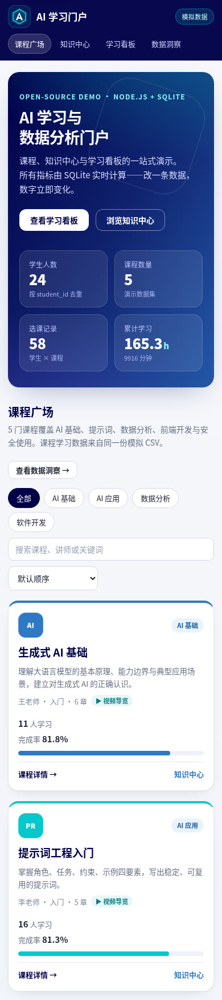

# AI Learning Portal

**AI 学习与数据分析门户** —— 一个零依赖、可直接运行的 Node.js + SQLite 教学演示项目。

[English](README.en.md) · [架构文档](docs/ARCHITECTURE.md) · [演示指南](docs/DEMO_GUIDE.md) · [贡献指南](CONTRIBUTING.md) · [安全策略](SECURITY.md)

[](#快速开始)
[](#技术栈)
[](#技术栈)
[](LICENSE)



覆盖 **课程广场、课程详情、知识中心、学习看板、数据洞察** 五个模块，并额外提供章节页与可编辑的数据演示面板。所有 KPI 都由 SQLite 中的原始学习记录计算——改一条数据，指标与图表立即变化。

> 这是一个演示/模板项目：数据与课程内容均为模拟内容，**没有登录与权限系统，不适合直接当作生产系统使用**。

---

## 目录

- [功能](#功能)
- [快速开始](#快速开始)
- [页面与截图](#页面与截图)
- [技术栈](#技术栈)
- [为什么不用 Vue / 构建工具](#为什么不用-vue--构建工具)
- [数据与指标口径](#数据与指标口径)
- [章节数据（推断口径）](#章节数据推断口径)
- [API](#api)
- [配置](#配置)
- [开发与测试](#开发与测试)
- [替换内容与视频](#替换内容与视频)
- [部署](#部署)
- [安全说明](#安全说明)
- [项目结构](#项目结构)
- [已知限制](#已知限制)
- [贡献](#贡献)
- [许可证](#许可证)

---

## 功能

- **课程广场**：5 门课程卡片，分类筛选、关键字搜索、按学习人数 / 完成率 / 成绩排序。
- **课程详情**：简介、讲师、难度、8 秒示例视频、带到达率的章节目录。
- **章节页（30 个）**：讲义原文、统一示例视频、本章测验、到达率与全课程章节对比、上/下一章。
- **知识中心**：每门课一套 200 字摘要、学习目标、5 个知识点、5 个术语、3 条 FAQ、3 道带答案解析的测验、原文摘录、AI 初稿 → 人工修正对照。
- **学习看板**：5 个 KPI、6 张纯 SVG 图表、课程筛选、数据源状态。
- **数据洞察**：由数据动态生成的洞察、指标公式表、常见口径误区。
- **数据演示面板**：编辑 / 新增 / 删除记录，导入 / 导出 CSV，恢复初始数据；每次变更后全部指标重新计算。
- **零依赖、零构建**：不需要 `npm install`，离线可用；图表不依赖 CDN。
- **响应式**：桌面与手机宽度均做了布局与图表适配。

## 快速开始

要求 **Node.js ≥ 24**（使用内置 `node:sqlite`，没有第三方依赖）。

```bash
git clone https://github.com/shinvdu/ai-learning-portal.git
cd ai-learning-portal

npm start
# 打开 http://127.0.0.1:8787
```

也可以直接执行 `./start.sh`（Linux/macOS）或双击 `start.bat`（Windows）。

- 首次启动自动创建 `data/portal.db`，并从 `data/learning_records.csv` 导入 177 条模拟学习记录。
- 局域网演示：`HOST=0.0.0.0 npm start`，访问 `http://<本机IP>:8787`。请只在可信网络内使用。

## 页面与截图

| 路由 | 页面 |
|---|---|
| `#/home` | 课程广场 |
| `#/course/C3` | 课程详情（视频 + 章节目录） |
| `#/chapter/C3/4` | 章节页（原文 + 视频 + 测验 + 推断数据） |
| `#/knowledge/C1` | 知识中心 |
| `#/dashboard` | 学习看板 |
| `#/insights` | 数据洞察 |

| 学习看板 | 章节页 |
|---|---|
|  |  |
| **知识中心** | **移动端** |
|  |  |

## 技术栈

| 层 | 选择 | 说明 |
|---|---|---|
| 后端 | Node.js 24 `node:http` | 手写路由、静态服务、JSON API，零框架 |
| 数据库 | `node:sqlite` | Node 内置 SQLite，无需编译原生模块 |
| 前端 | 原生 ES Modules + hash 路由 | 5 个视图，无构建步骤 |
| 图表 | 手写 SVG | 离线可用，不依赖 ECharts / CDN |
| 样式 | 原生 CSS + 自定义属性 | 深海军蓝 / 青绿色视觉系统，响应式 |
| 视频 | ffmpeg 生成的 8 秒 MP4 | 统一示例视频，支持 HTTP Range |
| 测试 | `scripts/verify.js` | 指标口径、内容完整性、资源校验 |

## 为什么不用 Vue / 构建工具

- 只有 6 个视图（5 个模块 + 章节页），状态简单，原生 hash 路由 + `fetch` 已经足够。
- 离线 / 内网 / U 盘环境下，零构建、零依赖最稳；不需要 `npm install` 或打包步骤。
- 图表手写 SVG，避免外部图表库加载失败导致页面空白。
- 这套结构也是一个“单文件 HTML 原型”的进阶参考：学生可以先做单文件版本，再理解前后端分离。

如果后续需要多角色登录、复杂组件复用、长期多人协作，再引入 Vue 3 + Vite 等方案是合理的。当前规模下，构建链带来的风险大于收益。

## 数据与指标口径

演示数据集：**177 条记录 / 24 名学生 / 5 门课程 / 58 条选课**（2026-11-04 至 2026-11-17）。

| 指标 | 口径 | 演示值 |
|---|---|---|
| 学生人数 | `COUNT(DISTINCT student_id)` | 24 |
| 课程数量 | `COUNT(DISTINCT course_name)` | 5 |
| 选课数 | `student_id + course_name` 唯一组合 | 58 |
| 平均完成率 | 每条选课取 `max(chapters_done) / total_chapters`，再对选课求平均 | 74.3% |
| 平均测验成绩 | 每条选课取有成绩的最大值，只统计有成绩的选课 | 86.4（有成绩 53 条 / 无成绩 5 条） |
| 累计学习时长 | `SUM(learning_minutes) / 60` | 165.3 小时（9916 分钟） |

CSV 字段：

```csv
student_id,course_name,learning_date,learning_minutes,chapters_done,total_chapters,quiz_score
S003,Python 数据分析,2026-11-04,79,2,8,
```

- 空成绩表示“未参加测验”，**不是 0 分**。
- 同一学生同一课程的多条记录视为一条选课，完成进度取 `max(chapters_done)`。
- 详细计算与边界情况见 [docs/ARCHITECTURE.md](docs/ARCHITECTURE.md)。

## 章节数据（推断口径）

原始 CSV **没有逐章记录**，只有“完成章节总数”。为了让章节页有可展示的数据，本项目使用可解释的推断口径：

```text
到达率 = max(chapters_done) ≥ 本章序号 的选课数 ÷ 本课程选课数
```

假设学生按顺序学习。页面明确标注“推断数据 / 推断值”，**不能当作原始逐章数据**。例如 Python 数据分析第 7、8 章到达率为 0%，说明原始数据中没有人完成到第 7 章。

如果需要精确的逐章数据，应在数据源中增加 `chapter_id` / `chapter_index` 字段，而不是依赖推断。

## API

| 方法 | 路径 | 说明 |
|---|---|---|
| GET | `/api/meta` | 概览指标、数据集状态、课程列表 |
| GET | `/api/courses?q=&category=` | 课程列表（含每门课统计） |
| GET | `/api/courses/:id` | 课程详情、统计、章节到达率 |
| GET | `/api/chapters/:courseId/:idx` | 章节原文、视频元数据、本章测验、章节统计 |
| GET | `/api/knowledge/:id` | 知识中心内容 |
| GET | `/api/dashboard?course=` | KPI、分课程统计、趋势、分布、洞察 |
| GET | `/api/insights` | 动态洞察、口径公式、常见误区、数据质量 |
| GET | `/api/records?q=&course=&student=&limit=&offset=` | 学习记录分页 |
| POST | `/api/records` | 新增记录（校验后写入） |
| PATCH | `/api/records/:id` | 修改记录（字段白名单） |
| DELETE | `/api/records/:id` | 删除记录 |
| POST | `/api/records/import` | 导入 CSV（JSON `{csv}` 或 `text/csv`），整表替换 |
| POST | `/api/admin/reset` | 恢复 `data/learning_records.csv` |
| GET | `/api/export.csv` | 导出当前记录（UTF-8 BOM） |

导入校验：课程必须在目录中；日期 `YYYY-MM-DD`；时长 0–1440 分钟；完成章节 ≤ 总章节；成绩 0–100 或留空。非法行会被跳过并返回行号与原因。

## 配置

| 环境变量 | 默认值 | 作用 |
|---|---|---|
| `PORT` | `8787` | 监听端口 |
| `HOST` | `127.0.0.1` | 监听地址；`0.0.0.0` 允许局域网访问 |
| `PORTAL_DB` | `data/portal.db` | 指定 SQLite 数据库文件 |

## 开发与测试

```bash
npm run dev      # node --watch，修改后端代码自动重启
npm run seed     # 恢复 data/learning_records.csv（清空手工修改）
npm run verify   # 校验指标、知识内容、章节、视频资源
npm test         # 同 verify
```

> `verify` / `seed` 都会重置学习记录；仅用于开发与 CI。

CI 会执行 `npm run verify`、语法检查，并启动服务做一次接口冒烟测试。

## 替换内容与视频

- 课程目录、知识内容、视频配置集中在 `src/content.js`。
- 章节原文放在 `data/lectures/*.txt`，启动时按“第 N 章”标题拆章写入数据库。修改讲义后重启服务即可重建。
- 课程视频默认使用 `public/assets/course-intro.mp4`（8 秒、960×540、H.264、无音频）。替换 `DEMO_VIDEO` 的 `src` / `poster` / `durationText` 即可。
- 每个章节页都有视频位，默认共用同一段示例视频（`CHAPTER_VIDEO_DEFAULT`）。需要单独替换某章时，在 `CHAPTER_VIDEOS` 里覆盖，例如：

```js
export const CHAPTER_VIDEOS = {
  'C3-4': { src: '/assets/chapter-c3-4.mp4', poster: '/assets/chapter-c3-4.jpg' }
};
```

正式视频建议使用 16:9、H.264 + AAC 的 MP4，单文件尽量小于 5MB。

## 部署

这是一个单进程 Node.js 应用：

```bash
HOST=0.0.0.0 PORT=8787 PORTAL_DB=/var/lib/ai-portal/portal.db npm start
```

- 建议放在 Nginx / Caddy 等反向代理之后，并启用 HTTPS。
- `data/portal.db` 是唯一持久化数据，注意备份。
- 静态资源与视频由同一进程提供，支持 HTTP Range。

## 安全说明

- **没有登录与权限系统**。`/api/records` 的写接口对任何能访问服务的人开放，仅适合本地演示或可信内网。
- 仅使用模拟数据；不要写入真实姓名、联系方式、成绩或公司数据。
- SQL 使用参数绑定；CSV 导入先校验后整表替换，失败回滚。
- 响应头包含 CSP（禁止内联脚本）、`X-Frame-Options`、`nosniff`、`Referrer-Policy`。
- 前端所有动态文本经 HTML 转义；请求体限制 2MB。
- 如需公开演示，建议先增加只读模式或反向代理层鉴权。详见 [SECURITY.md](SECURITY.md)。

## 项目结构

```text
.
├── server.js                  # HTTP 服务、API 路由、静态文件、Range 请求
├── src/
│   ├── db.js                  # SQLite 建表、种子导入、校验、CRUD、CSV 导入
│   ├── analytics.js           # KPI、分课程统计、图表数据、动态洞察、章节推断
│   ├── content.js             # 课程目录、知识内容、视频配置
│   └── csv.js                 # 无依赖 CSV 解析 / 导出
├── public/
│   ├── index.html
│   ├── css/styles.css
│   ├── js/app.js              # hash 路由、五个页面、章节页、测验、演示面板
│   ├── js/charts.js           # 纯 SVG 图表
│   └── assets/                # 示例视频、封面
├── data/
│   ├── learning_records.csv   # 模拟学习记录
│   ├── lectures/              # 5 门课讲义原文
│   └── portal.db              # 运行时生成（gitignored）
├── scripts/
│   ├── seed.js
│   └── verify.js
├── docs/
│   ├── ARCHITECTURE.md
│   ├── DEMO_GUIDE.md
│   └── screenshots/
└── .github/workflows/ci.yml
```

## 已知限制

- 无鉴权、无多用户隔离；写接口默认开放。
- 章节到达率是推断值，原始数据没有逐章记录。
- 单进程 SQLite，每次请求全量计算 177 条记录；真实数据量需要增量查询与缓存。
- CSV 导入是整表替换，不支持增量合并。
- 示例课程内容、学生数据与视频均为演示素材，不代表真实教学质量。
- 浏览器需要较新版本（原生 `<dialog>`、ES Modules、SVG、`<video>`）。

## 贡献

欢迎 Issue 与 PR。提交前请：

1. 运行 `npm run verify`；
2. 保持零 npm 依赖与零构建；
3. 新增课程 / 内容时同步更新文档与校验。

详见 [CONTRIBUTING.md](CONTRIBUTING.md)。

## 许可证

[MIT](LICENSE) © 2026 AI Learning Portal contributors

示例课程文本、学生数据与视频均为模拟/占位内容，仅用于演示。